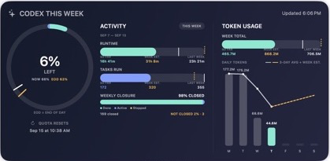
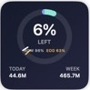
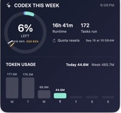

# Codex Week Widget

**[简体中文](README.zh-CN.md) · [Download v2.4.1](https://github.com/walkingbamboo/codex-week-widget/releases/tag/v2.4.1) · [MIT license](LICENSE)**

A native macOS WidgetKit dashboard for local Codex usage. It shows quota pacing,
runtime, completed tasks, and daily/weekly token activity in Small, Large, and
Extra Large widgets.

**No OpenAI API key is required.** The app reads Codex activity logs already
stored on your Mac and never uploads conversation content or usage data.



See how much Codex allowance is left, whether you are ahead of your weekly pace,
and how your activity compares with last week—without opening another dashboard.

Independent community project; not affiliated with or endorsed by OpenAI.

## Download and install

Get **Codex-Week-Widget-v2.4.1-Source-Installer.zip** from the
[release page](https://github.com/walkingbamboo/codex-week-widget/releases/tag/v2.4.1).
Unzip it, install the prerequisites below, and double-click **Install.command**,
or run `zsh ./scripts/install.sh` in Terminal. The installer builds and signs the
app locally with your own Apple Development team.

**This release is a source installation kit, not a notarized, ready-to-run app.**
You need full Xcode, a configured Apple development team, and Homebrew dependencies.
A Developer ID-signed and notarized app is not available in this release.

## Core features

- Refreshes automatically every 30 minutes by default. The interval is
  configurable during installation.
- Includes three native macOS layouts: **Small**, **Large**, and
  **Extra Large (Landscape)**.
- Designed so an iPhone or Apple Watch companion could be added later.
  **Phone and watch sync are not included in the current version.**

## Widget sizes

### Small



Shows the weekly quota ring plus today's and this week's token totals.

### Large



Adds this week's runtime, task runs, quota reset time, and the Monday-to-Sunday
token chart.

### Extra Large


Adds this-week, end-of-week estimate, and last-week comparisons for runtime,
task runs, and tokens. Values stay in three fixed columns: `SO FAR`,
`WEEK EST.`, and `LAST WEEK`. It also adds weekly closure and a token combo
chart whose bars show Monday-to-Sunday totals, solid line shows the three-day
moving average, and dashed continuation shows the current trend estimate.

## Interface guide

1. **Actual usage vs. theoretical usage** — the quota ring shows the real
   remaining weekly allowance. The white `NOW` marker shows the even-use target
   at the current moment. The amber `EOD` marker shows the target remaining at
   the end of today. Both follow the live quota window reported by Codex, so a
   manually triggered reset starts a new pacing window automatically.
2. **Runtime progress** — the Runtime row compares this calendar week with its
   end-of-week estimate and the preceding calendar week.
3. **Task progress and closure** — Tasks Run uses the same comparison. Weekly
   Closure separates completed, interrupted, and still-running task turns.
4. **Token pace and trend** — the week-total track compares this week's current
   total, end-of-week estimate, and last week's total. Daily bars use Monday
   through Sunday; the solid line is a three-day moving average and the dashed
   segment is its forward trend.
5. **Quota reset date** — Quota Resets shows when the current weekly usage
   window is scheduled to reset.

Quota pacing and activity history use separate clocks. A manual quota reset
changes only the quota ring, pacing markers, and reset date. It does not clear
this week's runtime, tasks, closure status, or daily token history.

## Requirements

- macOS 14 or newer
- Codex desktop app or CLI with local data in `~/.codex`
- Full Xcode installed in `/Applications/Xcode.app`
- An Apple Development signing identity and team configured in Xcode
  (personal-team signing depends on your account and Xcode provisioning)
- [Homebrew](https://brew.sh), XcodeGen, jq, and zstd

Install the command-line dependencies:

```bash
brew install xcodegen jq
```

## Install

Clone the repository and run the guided installer:

```bash
git clone https://github.com/walkingbamboo/codex-week-widget.git
cd codex-week-widget
chmod +x scripts/*.sh
zsh ./scripts/install.sh
```

The installer asks for:

1. Your 10-character Apple Developer Team ID
2. A unique bundle prefix such as `com.yourname`
3. Your Codex data directory (default: `~/.codex`)
4. Refresh interval (default: 30 minutes)
5. Your IANA timezone (automatically detected by default)

These values stay in local build settings or
`~/Library/Application Support/CodexWeek/config.env`; they are never committed.

The app is installed to `~/Applications/CodexWeek.app`. After installation,
right-click the desktop, choose **Edit Widgets**, search for **Codex Week**, and
pick a size.

## Find your Apple Developer Team ID

Open **Xcode → Settings → Accounts**, select your Apple ID and team, then copy
the Team ID. If necessary, create a simple macOS project once and let Xcode
manage signing for your personal team.

## Privacy and data source

Codex Week processes local rollout JSONL files and `state_5.sqlite` from the
configured Codex data directory. It extracts only timestamps, task completion
durations, token counters, and quota-rate-limit values. It does not send data
over the network and does not require a PAT or API credential.

The generated snapshot is atomically written to:

```text
~/Library/Application Support/CodexWeek/codex-week-snapshot.json
```

The Widget extension has read-only access to that directory. Automatic refresh
is managed by `~/Library/LaunchAgents/io.github.codexweek.refresh.plist`.

## Troubleshooting

### Widget is blank or disappears after changing size

```bash
zsh ./scripts/repair_widget.sh
```

If that does not help, remove the widget from the desktop, run the repair
script, and add it again.

### Data does not refresh

Check the background job and snapshot:

```bash
launchctl print gui/$(id -u)/io.github.codexweek.refresh
stat "$HOME/Library/Application Support/CodexWeek/codex-week-snapshot.json"
```

Refresh logs are stored in `~/Library/Logs/CodexWeek/`.

### Build signing fails

Verify the Team ID, use a unique bundle prefix, and confirm Xcode has downloaded
the signing certificate for that team. Re-run `zsh ./scripts/install.sh` after
correcting the value.

## Uninstall

```bash
zsh ./scripts/uninstall.sh
```

The app, LaunchAgent, and configuration are moved to Trash so they remain
recoverable.

## Project structure

- `App/` — macOS host app and manual refresh UI
- `Widget/` — WidgetKit views for all supported sizes
- `Shared/` — snapshot model and local file loading
- `scripts/collect_codex_week.sh` — local Codex log aggregation
- `scripts/install.sh` — guided build, signing, install, and background setup
- `project.yml` — XcodeGen project definition

## Notes

Codex log schemas are internal implementation details and may change in future
Codex releases. If metrics stop updating after a Codex update, open an issue
with the non-sensitive error output from `~/Library/Logs/CodexWeek/`.

Screenshots show the native widget UI from an earlier local build; the displayed
figures illustrate that captured usage and are not your own live data. Before a
valid snapshot exists, the UI falls back to built-in sample values. Quota comes
from the latest supported rate-limit event in local logs, not a live account API.
Token counts are activity estimates, not a bill; task counts describe logged
turns, not proof that a user project has been delivered. End-of-week forecasts
extrapolate recent activity and are not guarantees.

Validation for v2.4.1: local macOS Release build and synthetic collector regression
checks (plain/compressed logs, corrupt/missing history, previous snapshot preservation).
Installation and widget behavior on a second Mac have not been verified.

See [CHANGELOG.md](CHANGELOG.md) for release history.

## License

[MIT](LICENSE)
