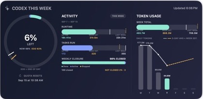
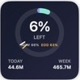
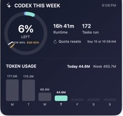

# Codex Week Widget

**[English](README.md) · [下载 v2.4.1](https://github.com/walkingbamboo/codex-week-widget/releases/tag/v2.4.1) · [MIT 许可证](LICENSE)**

把 Codex 的每周用量放到 Mac 桌面上：还剩多少额度、现在用得快不快、这一周做了多少，以及和上周相比有什么变化，抬眼就能看到。

不需要 OpenAI API Key。读取自己 Mac 上已有的 Codex 日志，使用记录和对话内容不会上传。本项目由社区独立开发，与 OpenAI 没有关联或背书关系。



## 下载与安装

到 [Release 页面](https://github.com/walkingbamboo/codex-week-widget/releases/tag/v2.4.1)下载 **Codex-Week-Widget-v2.4.1-Source-Installer.zip**，解压，准备好下列环境，然后双击 **Install.command**，或在终端运行：

```sh
zsh ./scripts/install.sh
```

**这是完整源码安装包，需要在自己的 Mac 上编译和签名。当前没有经过 Developer ID 签名及 Apple 公证、可直接拖入安装的 App。**

需要：

- macOS 14 或更新版本。
- Codex 桌面版或 CLI，以及 `~/.codex` 中已有的本地数据。
- 完整 Xcode，安装在 `/Applications/Xcode.app`。
- 在 Xcode 中配置自己的 Apple Development 签名身份和 Team。个人团队能否签名以你的账号与 Xcode 配置为准。
- Homebrew，以及以下工具：

```sh
brew install xcodegen jq zstd
```

安装时会询问 Apple Team ID、唯一的 Bundle 前缀、Codex 数据目录、刷新间隔和时区。Team ID 在 **Xcode → Settings → Accounts** 中查看。默认每 30 分钟收集一次，安装时可设为 5–1440 分钟。

App 安装到 `~/Applications/CodexWeek.app`。安装完成后，右键桌面 → 编辑小组件 → 搜索 **Codex Week** → 选择尺寸。WidgetKit 的实际更新时间也受 macOS 调度影响。

## 三种尺寸

### Small：看一眼剩余额度



额度圆环、今天和本周的 Token 总量。

### Large：看这一周的使用情况



增加本周运行时间、任务轮次、额度重置时间，以及周一到周日的 Token 图。

### Extra Large：和上周比较

超大横版在页首截图中展示。运行时间、任务轮次与 Token 都有三列：`SO FAR` 是本周目前的数据，`WEEK EST.` 是按当前速度推算的周末结果，`LAST WEEK` 是上周结果。另有任务轮次完成情况与每日 Token 趋势。

## 怎么读这些数字

- **额度圆环**：显示最近一条受支持日志中的剩余额度。白色 `NOW` 标记是当前时点的均匀使用参考，黄色 `EOD` 是今天结束时的参考。
- **两个时钟**：额度跟随 Codex 的重置周期；运行时间、任务轮次和 Token 按自然周统计。中途重置额度不会清掉本周活动。
- **趋势图**：柱状图是每日 Token，实线是三日移动平均，虚线是趋势估算。
- **统计边界**：任务轮次是日志事件统计，不代表真实项目已经交付；Token 不是账单；预测不是承诺。额度来自本地日志，并非实时账号接口。

截图是早前本机版本的原生界面记录，截图数字不代表你的实时数据。尚未生成有效快照时，界面会显示内置样例数据。当前界面为英文；本发布包提供中英文说明。

## 隐私与刷新

采集器读取配置目录中的 `state_5.sqlite` 和 rollout 日志，兼容 `.jsonl` 与 `.jsonl.zst`。只在本机提取时间、Token、任务事件和额度信息；运行时没有网络上传。

快照、配置和刷新日志分别位于：

```text
~/Library/Application Support/CodexWeek/codex-week-snapshot.json
~/Library/Application Support/CodexWeek/config.env
~/Library/Logs/CodexWeek/
```

后台任务为 `~/Library/LaunchAgents/io.github.codexweek.refresh.plist`。Codex 内部日志格式可能改变；缺失或损坏日志时，采集器明确报错并保留上一份快照。

## 遇到问题

组件空白或换尺寸后消失：

```sh
zsh ./scripts/repair_widget.sh
```

再移除并重新添加组件。签名失败时，检查 Team ID、Bundle 前缀和 Xcode 签名证书。数据不更新时，检查上面的刷新日志，确认 `jq`、`zstd` 已安装。分享错误信息前先去掉个人路径和对话内容。

## 卸载

```sh
zsh ./scripts/uninstall.sh
```

App、后台任务和配置会移到废纸篓，可恢复。

## 本次发布

v2.4.1 补齐正式下载包、中英文说明和截图，包含压缩日志兼容、错误时快照保护，以及后台任务的 Homebrew 路径修复。

已做本机 macOS Release 编译和合成日志回归检查，覆盖普通/压缩日志一致性、日志缺失/损坏与快照保护。尚未在第二台 Mac 上验证安装与组件行为。iPhone、Apple Watch 同步未包含在本版中。

更多技术说明见 [英文文档](README.md)，历史变更见 [CHANGELOG.md](CHANGELOG.md)。
